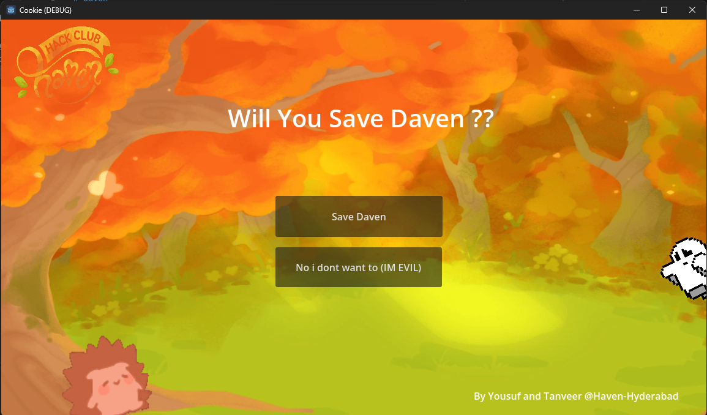
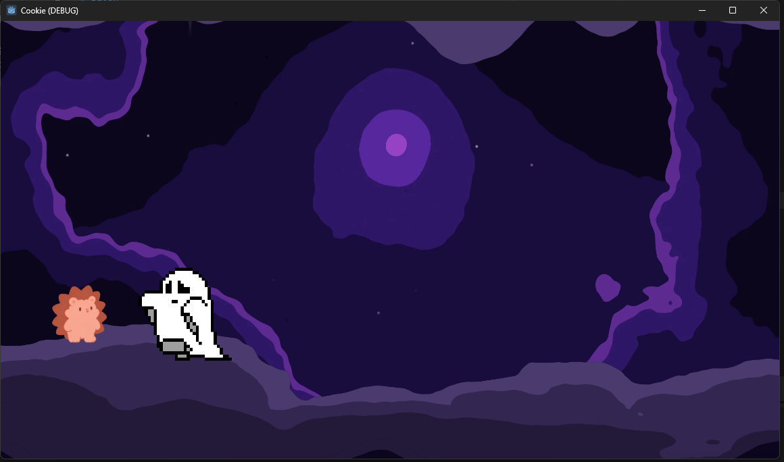
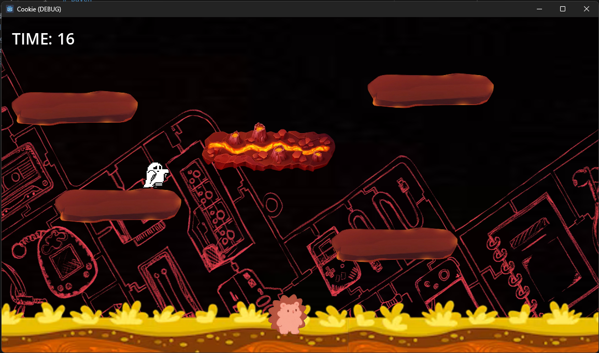
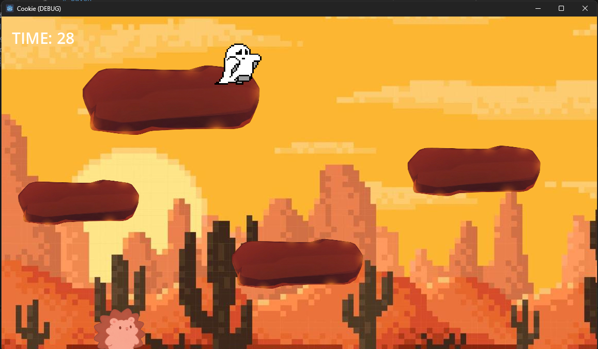
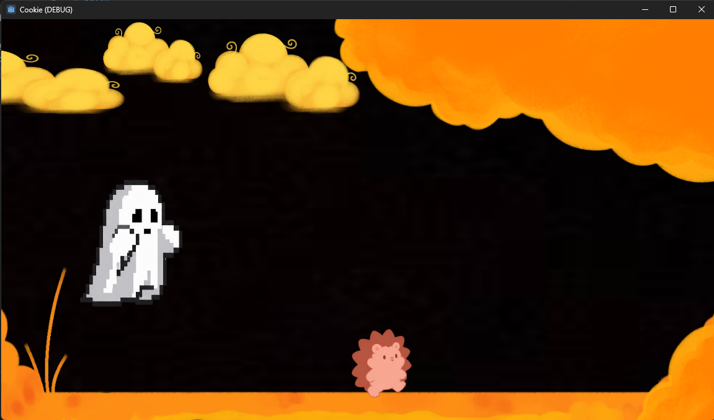

# Daven 

- Save him 
- 2 player game based in Haven about saving Daven from a bad Ghost !!!! 

Daven is a hedgehog lives at Haven 
- one happy evening -> 
a ghost came across Haven and saw Daven sleeping 
and started chasing him across Haven 
Mission: Save Daven and Haven !!
`remeber that Ghost can Fly and pass through Walls using his intangibility !!!`

Play on WEB [itch](https://1m8anana.itch.io/daven)

## Levels 

- Traning session of 10sec 

- Level 1 - can respwan 

- Level 2 - HARD-CORE (either Ghost or Daven Win)

## Loading 

## Controls 

### Daven 
- Left Arrow - left directionn 
- Right Arrow - right directionn 
- Space Bar - Jump 

### Ghost 
- W - Fly UP 
- A - FLy & go Left 
- S - Fly & go down 
- D - Fly & go Right 
remember Ghost is Slower than Daven but Ghost uses his `Intangibility to pass through walls`
- left SHIFT - use intangibilty 

## Features 

- Multiple Maps
- A Training Session(10 sec)
- Scence shift when Daven Wins
- 2 player ( Multiplayer )
- Multiple Maps(2 for now)

## Assets 
- Haven Webpage
- Cresent Repo (for training session)
- Pinterest for simple reference of ghost

# Updates coming 
- Single Player
- better Training Session
- **Tag System**
- **Ghost Story** Release 
- and some secrets

  
## AI Contribution 

Only to connect scences and Ghost Intangibility 
and Debugging: 
	- Loading Animation
	- Reset Timer according to the condition 
	
